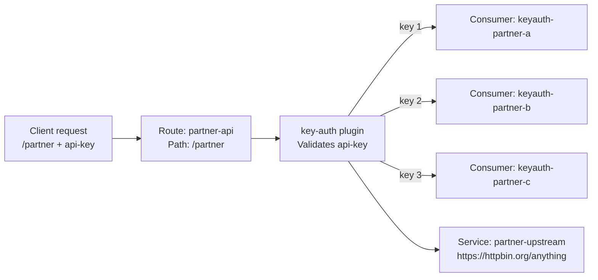

# Kong Compose demo

This project runs Kong Gateway with PostgreSQL and Konga. Kong exposes one API route protected by an API key.

## Start

Run from this directory:

```sh
docker compose up -d
```

Kong reloads changes to `kong.yml` automatically. Start the stack normally:

```sh
docker compose up -d --build
```

The `kong-configure` container checks the mounted `kong.yml` every second and runs `deck gateway sync` after every saved change. Kong itself stays running. Check a reload with:

```sh
docker compose logs -f kong-configure
```

## Endpoints

| Service | URL | Purpose |
| --- | --- | --- |
| Kong proxy | `http://localhost:8000` | API requests |
| Kong Admin API | `http://localhost:8001` | Local Kong administration |
| Konga | `http://localhost:1337` | Kong web UI; the local Kong connection is seeded on first run |

## API keys and Consumers

The route `GET /partner` is configured in `kong.yml`:

| Request API key | Kong Consumer | Consumer custom ID |
| --- | --- | --- |
| `api-key: 1` | `keyauth-partner-a` | `partner-a` |
| `api-key: 2` | `keyauth-partner-b` | `partner-b` |
| `api-key: 3` | `keyauth-partner-c` | `partner-c` |

The `key-auth` plugin validates the `api-key` header and identifies the Consumer. The upstream is `https://httpbin.org/anything`.

### Consumer

A **Consumer** represents an API client, such as a partner system. Kong uses the API key to identify the Consumer that made the request. Here, `keyauth-partner-a`, `keyauth-partner-b`, and `keyauth-partner-c` own keys `1`, `2`, and `3`, respectively.

A Consumer can be configured with identity fields (`username` and `custom_id`), authentication credentials, and plugins scoped to that Consumer.

### Plugins

A **plugin** applies behavior to requests. The route's `key-auth` plugin validates the API key.

### Consumer vs. plugin

| | Consumer | Plugin |
| --- | --- | --- |
| Role | Identifies the API client | Applies behavior to requests |
| Example | `keyauth-partner-a` owns API key `1` and has `custom_id: partner-a` | `key-auth` checks `api-key` |
| When used | Kong resolves it after successful authentication | Kong runs plugins at their configured scope and priority |

For this route, `key-auth` identifies the Consumer after validating the API key.

For example, the Consumer stores key `1` and has `custom_id: partner-a`. The route's `key-auth` plugin reads the `api-key` header and identifies that Consumer:

```yaml
consumers:
  - username: keyauth-partner-a
    custom_id: partner-a
    keyauth_credentials:
      - key: "1"

plugins:
  - name: key-auth
    route: partner-api
    config:
      key_names:
        - api-key
```



## Try the requests

Open `kong.http` in an HTTP client such as the VS Code REST Client extension and run the requests. The upstream response shows the forwarded headers. The file includes requests for all three mappings and a missing-key case, which should return `401`.

For a direct check:

```sh
curl -i http://localhost:8000/partner -H 'api-key: 1'
curl -i http://localhost:8000/partner -H 'api-key: 2'
curl -i http://localhost:8000/partner -H 'api-key: 3'
```

The upstream response shows the request headers received by httpbin. Kong does not add a `partner` header.

## Configuration files

- `compose.yaml` defines Kong, PostgreSQL, migrations, and Konga.
- `kong.yml` defines the service, route, Consumers, and plugins.
- `kong.http` contains example requests.
- `konga-node-seed.js` seeds the local Kong Admin API connection in Konga on first run.

Kong and PostgreSQL use the named volume `kong_data`, so database contents persist across container restarts. `kong-configure` uses decK to make Kong match `kong.yml`; entities that are absent from that file are removed. Keep the file as the source of truth and avoid adding unmanaged entities in Konga.

The demo credentials and `NO_AUTH=true` are for local use only. The Admin API and Konga are bound to localhost; the proxy is exposed on port `8000`.
